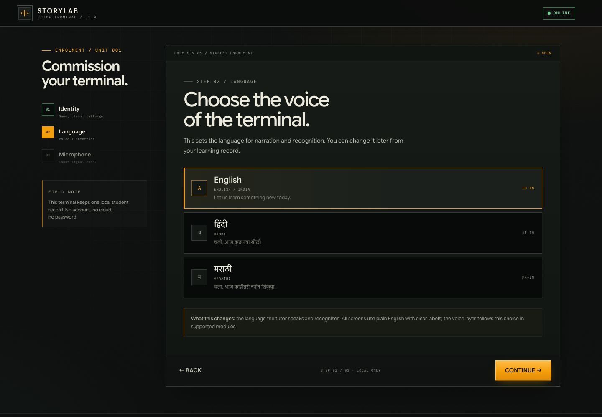
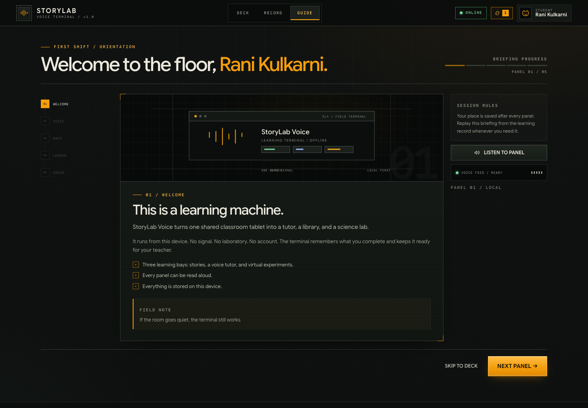
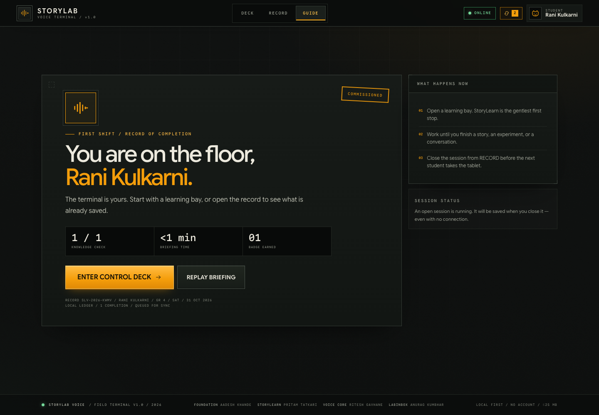
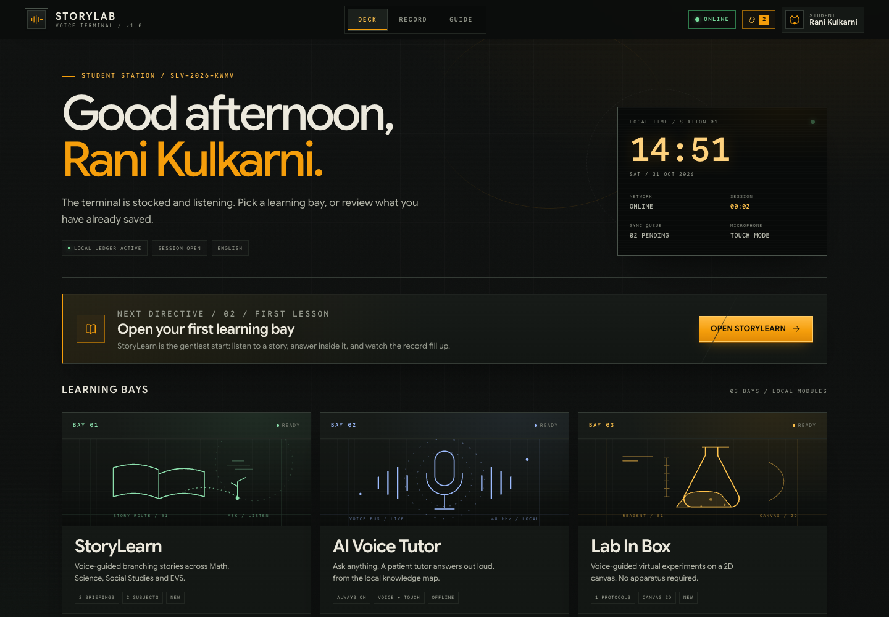
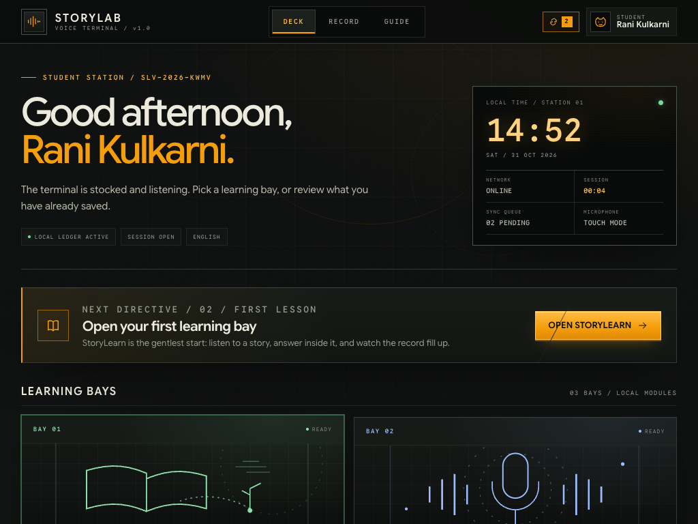
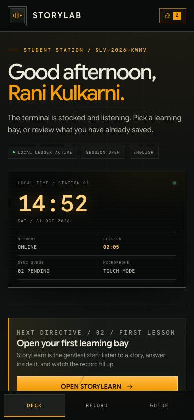
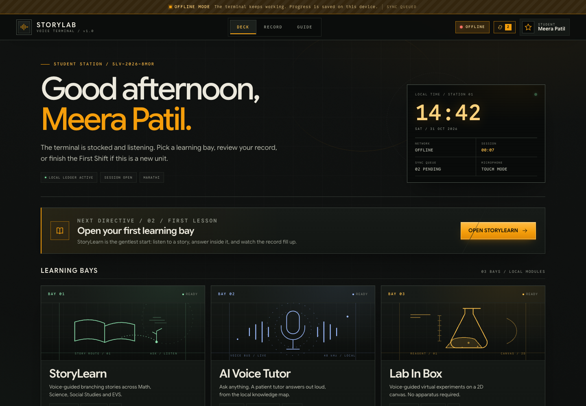

# StoryLab Voice (Release 1.0)

> **A Voice-Guided Educational Ecosystem with AI Assistant, Multi-Subject Stories, and Virtual Labs**  
> *Developed for resource-constrained rural schools with an offline-first architecture.*

[]()
[]()
[](.ai/DESIGN.md)
[](SAD_Assignment1-1-1.pdf)

---

## 📑 Table of Contents
1. [Overview](#-overview)
2. [Team & Responsibility Matrix](#-team--responsibility-matrix)
3. [System Architecture & UML Design Mapping](#-system-architecture--uml-design-mapping)
4. [Screenshots & Visual Tour](#-screenshots--visual-tour)
5. [Key Technical Features](#-key-technical-features)
6. [Offline-First Architecture & Storage](#-offline-first-architecture--storage)
7. [Getting Started & Local Setup](#-getting-started--local-setup)
8. [Documentation Index & References](#-documentation-index--references)

---

## 📖 Overview

**StoryLab Voice** is an offline-first Progressive Web Application (PWA) developed for rural and resource-constrained schools where physical laboratory facilities, textbooks, and high-speed broadband are unavailable.

Rather than forcing students to navigate text-heavy interfaces, students aged 6–15 interact directly with an **AI Voice Assistant Companion** serving as a personal tutor:
- **StoryLearn**: Contextualized, interactive multi-subject branching narratives across Mathematics, Science, Social Studies, and Environmental Studies (EVS).
- **LabInBox**: A 2D virtual science laboratory simulator where students manipulate apparatus and observe reactions using speech.
- **Control Deck & Learning Record**: Personal profile enrollment, session time tracking, activity ledgers, and background synchronization over intermittent cellular networks.

---

## 👥 Team & Responsibility Matrix

Developed as part of the **Software Architecture and Design (SAD)** coursework:

| Member | PRN / Roll No. | Subsystem Responsibility | Module Handover |
| :--- | :--- | :--- | :--- |
| **Aadesh Khande** | **202401100090** | **Lead & Foundation**: Shell, Router, IndexedDB, Service Worker, Design System, Onboarding & Control Deck | [PART_0_FOUNDATION.md](.ai/PART_0_FOUNDATION.md) |
| **Pritam Tatkari** | **202401100099** | **Part 1 — StoryLearn**: Branching audio story engine, narrative progression, and voice assessment | [HANDOVER_PRITAM.md](HANDOVER_PRITAM.md) |
| **Ritesh Gavhane** | **202401100082** | **Part 2 — Chatbot Core**: Web Speech STT/TTS engine, state waveform animations, and intent matching | [HANDOVER_RITESH.md](HANDOVER_RITESH.md) |
| **Anurag Kumbhar** | **202401100109** | **Part 3 — LabInBox**: 2D HTML5 Canvas simulation engine, apparatus rendering, and voice actions | [HANDOVER_ANURAG.md](HANDOVER_ANURAG.md) |

---

## 🏛️ System Architecture & UML Design Mapping

The project's architectural models are documented according to IEEE Std 830-1998 and ISO/IEC 25010:2011:

```
                          ┌────────────────────────────┐
                          │   App Shell & Hash Router  │
                          └──────────────┬─────────────┘
                                         │
                 ┌───────────────────────┼──────────────────────┐
                 ▼                       ▼                      ▼
      ┌────────────────────┐  ┌────────────────────┐  ┌──────────────────┐
      │  Part 1: StoryLearn│  │  Part 2: AI Chatbot│  │ Part 3: LabInBox │
      │  Branching Stories │  │  Voice Tutor Core  │  │ 2D Virtual Lab   │
      └──────────┬─────────┘  └──────────┬─────────┘  └────────┬─────────┘
                 │                       │                     │
                 └───────────────────────┼─────────────────────┘
                                         ▼
                          ┌────────────────────────────┐
                          │ Web Speech API (TTS & STT) │
                          └──────────────┬─────────────┘
                                         ▼
                          ┌────────────────────────────┐
                          │ IndexedDB Storage & Sync   │
                          │   ('storylab_v1' Database) │
                          └────────────────────────────┘
```

| Practical Assignment | UML Model / Specification | Description | Primary Document |
| :--- | :--- | :--- | :--- |
| **SRS Document** | **IEEE Std 830-1998 SRS** | Complete Software Requirements Specification & Spiral SDLC analysis | [SAD_Assignment1-1-1.pdf](SAD_Assignment1-1-1.pdf) |
| **Practical 02** | **Use Case Analysis** | Primary actors (*Student, Teacher, Admin, AI Assistant*) and core use cases | [sadas2.pdf](sadas2.pdf) |
| **Practical 03** | **Structural Design** | UML Class, Deployment, and Package diagrams | [sadas3-1.pdf](sadas3-1.pdf) |
| **Practical 04** | **Component & Architecture** | UML Component, Composite Structure, and Profile diagrams | [sadas4-1.pdf](sadas4-1.pdf) |
| **Practical 05** | **Workflow & State Models** | UML Activity diagrams and State Machine diagrams for voice interaction | [sadas5.pdf](sadas5.pdf) |
| **Practical 06** | **Interaction Diagrams** | UML Sequence diagrams and Communication diagrams for speech parsing | [sadas6.pdf](sadas6.pdf) |
| **Practical 07** | **Complex Interactions** | Interaction Overview and Timing diagrams for voice latency constraint (≤ 1.8s) | [sadas7.pdf](sadas7.pdf) |
| **System Architecture** | **Technical Blueprint** | Complete system data flow, schema, and API contracts | [docs/ARCHITECTURE.md](docs/ARCHITECTURE.md) |

---

## 📸 Screenshots & Visual Tour

The UI follows a functional **Industrial Field-Terminal** aesthetic with high contrast, tactile mechanical indicators, and responsive layouts across desktop, tablet, and mobile.

| Screen | Description | Preview |
| :--- | :--- | :--- |
| **Language Selection** | Vernacular onboarding (English, Marathi, Hindi) with audio preview |  |
| **Interactive Briefing** | First Shift introductory walkthrough and audio verification check |  |
| **Achievement Certificate** | First Shift completion record, badge award, and session initiation |  |
| **Control Deck (Desktop)** | Central command dashboard with session timer, status readouts, and module cards |  |
| **Control Deck (Tablet)** | Adaptive view optimized for 1024px classroom tablets |  |
| **Mobile Navigation** | Smartphone view (390px) with custom bottom navigation dock |  |
| **Offline Verification** | 100% operational in disconnected mode with amber offline indicator |  |

---

## ⚡ Key Technical Features

1. **Zero External Runtime Dependencies**: Built with vanilla HTML5, CSS3, and modern JavaScript. Runs without Node.js or heavy frontend bundlers.
2. **Self-Hosted Typography**: Fully self-contained font bundle featuring Google Sans Flex (variable 300–800) and Google Sans Code in WOFF2 format.
3. **On-Device Voice Engine**: Utilizes W3C Web Speech API (`SpeechSynthesis` and `SpeechRecognition`) configured for Indian English (`en-IN`) and vernacular fallbacks.
4. **Strict Performance Budgets**:
   - Total bundle footprint ≤ 25 MB.
   - Speech-to-response generation ≤ 1.8s on 2 GB RAM hardware.
   - Text contrast ≥ 4.5:1 (WCAG AA).

---

## 💾 Offline-First Architecture & Storage

- **Asset Caching**: Service Worker (`sw.js`) employs a Cache-First strategy pre-caching the application shell, fonts, JSON lessons, and lab apparatus configs.
- **Transactional Persistence**: Uses HTML5 IndexedDB (`storylab_v1`):
  - `progress`: Holds cumulative story and experiment completion records per student.
  - `sync_queue`: Automatically queues progress events while offline.
- **Background Synchronization**: Integrates the W3C Background Sync API to drain the sync queue automatically once 2G/3G connectivity is detected.

Detailed offline architectural specifications are documented in [`.ai/OFFLINE.md`](.ai/OFFLINE.md).

---

## 🚀 Getting Started & Local Setup

### Running the Application

Clone the repository and start the demo server. It serves the app **and** proxies tutor questions, so the AI answer and the saved topics both work:

```bash
# Clone the repository
git clone https://github.com/debugonaut/StoryLab-Voice.git
cd StoryLab-Voice

# 1. Add your key once (never commit it)
cp .env.example .env
# edit .env and set GROQ_API_KEY=... from https://console.groq.com/keys

# 2. Run the server (Node 18+) — no install step, no dependencies
node tools/server.mjs
```

Open `http://127.0.0.1:8123` in Google Chrome or Microsoft Edge on desktop or Android, and allow the microphone when the browser asks.

Without a key the app still runs: the badge shows **OFFLINE** and the tutor answers its starter topics. Voice recognition needs `localhost`/`127.0.0.1` (or HTTPS) plus a network connection, because Chromium sends audio to its speech service.

> Do not serve this project with `python3 -m http.server` for the demo: static-only hosts have no `/api/tutor`, so free-form questions cannot be answered.

### Demo checks

```bash
npm start            # same as node tools/server.mjs
npm test             # smoke tests: routes, tutor error paths, guardrail, streaming
curl http://127.0.0.1:8123/api/tutor/health
```

`health` must report `"configured":true` before the presentation; otherwise the tutor works only from its saved topics.

### Sharing with a tablet or second device

The server binds `127.0.0.1` by default. On a LAN use:

```bash
HOST=0.0.0.0 PORT=8123 node tools/server.mjs
```

Then open `http://<laptop-ip>:8123` on the device. **The microphone will not work over plain HTTP on another device** — Chromium only grants it on `localhost` or HTTPS. For a tablet demo, either present from the laptop or put the server behind HTTPS (a tunnel or a local certificate).

### Tutor behaviour

- Free-form questions go to the model in the student's language, streamed into the readout.
- The last three exchanges are sent as context, so follow-ups like "and why?" work.
- Story and lab screens have **ASK ABOUT THIS**, which carries the current step into the tutor.
- A guardrail refuses clearly unsuitable questions before they reach the provider.
- Starter chips and the lesson library keep working offline, and are used whenever the model is unavailable.

---

## 📚 Documentation Index & References

- **Core Documentation**:
  - [PRODUCT.md](PRODUCT.md) — Product vision, constraints, and target user characteristics.
  - [docs/ARCHITECTURE.md](docs/ARCHITECTURE.md) — Comprehensive technical architecture and contract reference.
  - [HANDOVER_INDEX.md](HANDOVER_INDEX.md) — Master integration guide, API signatures, and data contracts.
- **Teammate Handover Briefs**:
  - [HANDOVER_PRITAM.md](HANDOVER_PRITAM.md) — StoryLearn narrative module implementation guide.
  - [HANDOVER_RITESH.md](HANDOVER_RITESH.md) — Chatbot Core voice pipeline implementation guide.
  - [HANDOVER_ANURAG.md](HANDOVER_ANURAG.md) — LabInBox canvas simulator implementation guide.
- **Planning & Verification**:
  - [.ai/PLAN.md](.ai/PLAN.md) — Master sprint plan and component breakdown.
  - [.ai/DESIGN.md](.ai/DESIGN.md) — Industrial design tokens, typography, and styling guidelines.
  - [.ai/OFFLINE.md](.ai/OFFLINE.md) — PWA caching, IndexedDB schema, and offline protocols.
  - [.ai/BUILD_LOG.md](.ai/BUILD_LOG.md) — Checkpoint verification and integration milestones.
- **Coursework Specifications & SRS**:
  - [SAD_Assignment1-1-1.pdf](SAD_Assignment1-1-1.pdf) — IEEE Std 830-1998 Software Requirements Specification.
  - [sadas2.pdf](sadas2.pdf) — Practical 02 (Use Case Diagrams).
  - [sadas3-1.pdf](sadas3-1.pdf) — Practical 03 (Class, Deployment, Package Diagrams).
  - [sadas4-1.pdf](sadas4-1.pdf) — Practical 04 (Component, Composite Diagrams).
  - [sadas5.pdf](sadas5.pdf) — Practical 05 (Activity, State Machine Diagrams).
  - [sadas6.pdf](sadas6.pdf) — Practical 06 (Sequence, Communication Diagrams).
  - [sadas7.pdf](sadas7.pdf) — Practical 07 (Timing, Interaction Overview Diagrams).
