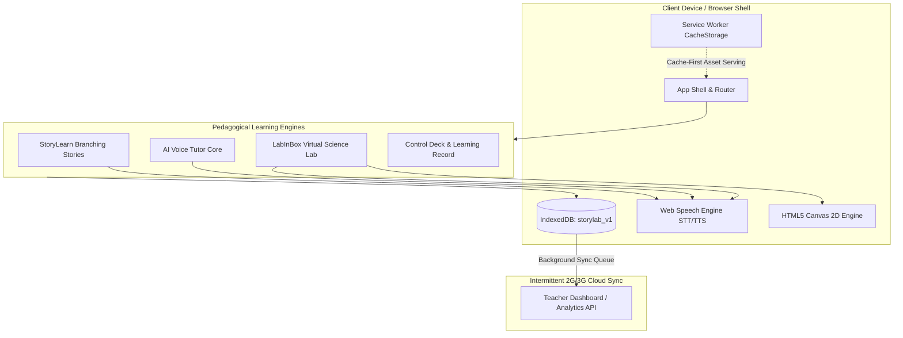

# System Architecture & Technical Specifications — StoryLab Voice

This document details the architectural design, UML models, data flow, and hardware/software constraints for **StoryLab Voice (Release 1.0)**, developed in accordance with **IEEE Std 830-1998** and **ISO/IEC 25010:2011**.

---

## 🏛️ 1. High-Level Architecture Overview

StoryLab Voice is an offline-first, client-side Progressive Web Application designed to operate in low-resource environments (Android 8+, 2 GB RAM, ≤ 25 MB storage budget, zero persistent connectivity).



---

## 📊 2. UML Diagrams & Academic Practical Mapping

The system design was developed across seven Software Architecture and Design (SAD) practical milestones:

| Practical | UML Modeling Domain | Key Focus Areas | Reference Document |
| :--- | :--- | :--- | :--- |
| **SRS** | **IEEE 830 Specification** | Spiral SDLC model, risk-driven iterations, edge AI voice constraints | [SAD_Assignment1-1-1.pdf](../SAD_Assignment1-1-1.pdf) |
| **PR-02** | **Use Case Analysis** | Actors: *Student*, *Teacher*, *Admin*, *AI Assistant*; Use Cases: UC-01 (Chatbot), UC-02 (StoryLearn), UC-03 (LabInBox) | [sadas2.pdf](../sadas2.pdf) |
| **PR-03** | **Structural Design** | Class, Deployment (PWA to low-spec Android), and Package diagrams | [sadas3-1.pdf](../sadas3-1.pdf) |
| **PR-04** | **System Architecture** | Component diagrams, Composite structure, and UML Profile extensions | [sadas4-1.pdf](../sadas4-1.pdf) |
| **PR-05** | **Workflow & State** | Activity diagrams for lesson branches; State Machines for voice interaction states (`idle`, `listening`, `thinking`, `speaking`) | [sadas5.pdf](../sadas5.pdf) |
| **PR-06** | **Interaction Diagrams** | Sequence diagrams for voice query processing; Communication diagrams for canvas apparatus updates | [sadas6.pdf](../sadas6.pdf) |
| **PR-07** | **Complex Interactions** | Interaction Overview and Timing diagrams for the 1.8s voice latency budget | [sadas7.pdf](../sadas7.pdf) |

---

## 💾 3. Offline-First Storage & Data Contracts

### 3.1 IndexedDB Schema (`storylab_v1`)

```javascript
// Database: storylab_v1
// Object Store 1: 'progress' (key: 'student')
{
  "stories": {
    "math-market": { "completed": true, "timestamp": 1730000000000 },
    "science-plants": { "completed": true, "timestamp": 1730000001000 }
  },
  "labs": {
    "acid-base": { "completed": true, "timestamp": 1730000002000 }
  }
}

// Object Store 2: 'sync_queue' (auto-increment key)
{
  "id": 1,
  "type": "analytics",
  "payload": { "event": "lab.completed", "labId": "acid-base" },
  "timestamp": 1730000002100
}
```

### 3.2 Service Worker Caching Strategy
- **Static Assets & App Shell**: Cache-first (`CACHE_VERSION = 'storylab-v3'`) pre-caching HTML, CSS, JavaScript, self-hosted Google Sans fonts, and JSON datasets.
- **Analytics Sync**: Queued locally in IndexedDB when offline; automatically flushed via W3C Background Sync API (`analytics-flush`) or window `online` listeners.

---

## 🔌 4. Core Public JavaScript API Contracts

All modules communicate through strictly typed, decoupled contracts exposed on `window`:

```typescript
// 1. Storage Interface (Foundation)
window.DB.save(store: string, key: string, value: any): Promise<void>;
window.DB.load(store: string, key: string): Promise<any>;
window.DB.getAll(store: string): Promise<any[]>;
window.DB.queueSync(payload: object): Promise<void>;

// 2. Conversational Voice Interface (Chatbot Core)
window.Chatbot.speak(text: string): Promise<void>;
window.Chatbot.listen(): Promise<string>;
window.Chatbot.state: 'idle' | 'listening' | 'thinking' | 'speaking';

// 3. Application Routing Interface (Shell)
window.StoryLabRouter.navigate(route: 'home' | 'storylearn' | 'chatbot' | 'labinbox' | 'record'): void;

// 4. State & Session Ledger (Shell State)
window.StoryLabState.getProfile(): StudentProfile;
window.StoryLabState.logEvent(type: string, description: string, meta: object): Promise<void>;
```

---

## 🎨 5. Industrial Design Language

Designed following field-instrument panel aesthetics:
- **Zero-Radius Edges**: All panels, buttons, and inputs strictly adhere to `border-radius: 0px`.
- **Palette**: Dark forge black (`#111111`), steel panel (`#1c1c1c`), and warning amber (`#f59e0b`) for active interactive states.
- **Visual Feedback**: Mechanical ventilation slot separators, corner rivet markings (`◈`), and live 5-bar animated audio waveforms.
- **Typography**: Self-hosted Google Sans Flex and Google Sans Code (WOFF2) with strict WCAG AA contrast compliance (minimum 4.5:1 on all text).
